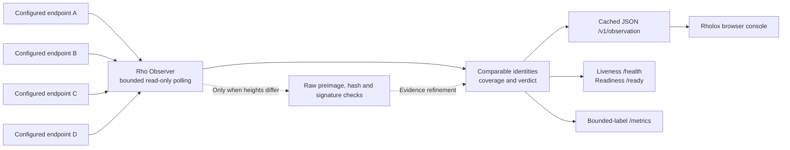

<div align="center">

# Rho Observer

**Read-only network evidence. Explicit uncertainty.**

A bounded Rust observer for comparing finalized-state reports across Rholo / RChain endpoints.
It records what each configured source actually returned instead of treating one HTTP gateway as network truth.

[](https://github.com/rhovision-org/rho-observer/actions/workflows/ci.yml)
[](https://www.rust-lang.org/)
[](#trust-boundary)

[Live Rholox workspace](https://rholox.com/#rho-observer) ·
[Public observation](https://testnet.rhobot.net/observer/v1/observation) ·
[Service health](https://testnet.rhobot.net/observer/health) ·
[Assurance matrix](docs/ASSURANCE.md)

</div>

> **Observation is not consensus certification.** Agreement among reachable endpoints, cryptographically verified ancestry, full node coverage and stake-weighted finality are different claims. Rho Observer makes their boundaries visible.

## Navigate

[Architecture](#architecture-at-a-glance) · [Evidence semantics](#evidence-at-a-glance) ·
[Trust boundary](#trust-boundary) · [Quick start](#build-and-run) ·
[HTTP API](#http-contract) · [Verification](#reproducible-verification) ·
[Deployment & rollback](#deployment)

## Architecture at a glance



Configured endpoints are operator-selected sources. Four endpoints are shown for illustration, not a fixed protocol quorum or proof of independent operators. Browser reads use the cache; they do not trigger fresh validator fan-out.

## Evidence at a glance

| Question | What is checked | What is **not** inferred |
| --- | --- | --- |
| Do snapshots match? | Complete, comparable (network, shard, height, hash) identities | That a source is a bonded validator or that a finality certificate exists |
| Can different heights connect? | Bounded raw justification ancestry, BLAKE2b-256 content address and proposer signature | Independent Casper validation or stake-weighted quorum |
| Is the observer responding? | HTTP liveness via `/health` | Freshness or complete coverage |
| Is the report ready? | Monotonic freshness, full comparable/reachable coverage, at least two sources, agreement or proven lag | That chain height is progressing |
| Can it be monitored? | Cached, fixed-cardinality `rho_observer_*` metrics | Network truth from successful scrapes |

Every verdict is evidence-scoped: `agreement`, `proven_lag`, `height_skew`, `majority`, `conflicting_finalized_history`, `divergence` or `unavailable`.

**Project creator and lead developer:** [AixAria (`@aixaria0`)](https://github.com/aixaria0). Source hosted at [rhovision-org/rho-observer](https://github.com/rhovision-org/rho-observer). Hosting and project authorship are separate; contributors retain rights in their respective contributions.

[Rholox](https://rholox.com) · [Hosted observation API](https://testnet.rhobot.net/observer/v1/observation) · [Hosted health](https://testnet.rhobot.net/observer/health) · [DApp guide](docs/BUILDING-DAPPS.md)

The hosted deployment can run a different revision from this repository. Inspect `/health` and its `version` field before assuming that a source change has been deployed. Older deployments do not expose that field.

## Release record

| Item | Recorded value |
| --- | --- |
| Verified hosted baseline | `0.2.0` (23 October 2026; not automatically updated) |
| Current main source | `0.3.0`; CI on [merge `3933e432`](https://github.com/rhovision-org/rho-observer/actions/runs/42302946085) passed, independent of deployment |
| Report schema | `schema_version: 1` |
| Integration | [PR #4](https://github.com/rhovision-org/rho-observer/pull/4), merge `a5d0796` |
| Post-merge verification | [CI run 39885469376](https://github.com/rhovision-org/rho-observer/actions/runs/39885469376), all four jobs successful |
| Browser consumer | [Rholox](https://rholox.com/); source and live deployment may differ |
| Production check | 23 October 2026: health/readiness returned 200, version 0.2.0, fresh complete 4/4 coverage and single public CORS/cache headers |

The installed 0.2.0 binary came from the digest-verified CI artifact at `6f94f76`. The subsequent `1abec73` change covered proxy configuration, documentation and CI, without changing Rust source. The merged source tree matches that reviewed head. This is a dated deployment record, not an assertion that every later commit is already running.

## License and attribution

Rho Observer is distributed under the **Apache License, Version 2.0**.
Read [LICENSE](LICENSE) for the full legal terms and [NOTICE](NOTICE) for
project attribution. The license permits reuse, redistribution and modification,
subject to its notice and change-documentation conditions, and includes an
express patent grant. It does not grant trademark rights, guarantee service
availability, or establish a network consensus certificate.

Repository location is not an ownership claim. Copyright in contributions
remains with the respective rightsholders, as documented by repository history.

## Identity and compatibility

The GitHub repository is now [rhovision-org/rho-observer](https://github.com/rhovision-org/rho-observer).
The Rust package, binary artifact, systemd user and deployed executable intentionally retain
the legacy `rchain-observer` identifier for deployment compatibility. The CLI help
identifies the product as Rho Observer. Do not rename or restart the installed
systemd service as part of this repository-only release; migrate deployment paths
separately with a tested rollback.

## Trust boundary

The service answers **what the configured endpoints reported, whether their finalized identities match, and whether bounded raw justification paths connect different reported heights**.

It does not independently run Casper, execute blocks, authenticate the network ID, validate a validator bond set or stake quorum, or verify a consensus finality certificate. A valid block signature establishes possession of its proposer key; membership and authorization of that key are separate questions. Network and finalized status originate from node HTTP responses. Raw block hashes and proposer signatures are checked only for traversed ancestry evidence, not for every matching snapshot.

Endpoint diversity is operator configuration. Different labels and URLs do not prove independently controlled nodes. Agreement is a comparison of available evidence, not an authorization decision. In particular, **one comparable node can yield `agreement` while coverage remains insufficient**. Preserve the observed/comparable/reachable denominators.

The observer holds no signing keys and submits no deploys, proposals or admin mutations. Applications remain responsible for their own execution, authorization and risk policies.

## Build and run

```bash
cargo build --release --locked

./target/release/rchain-observer \
  --node A=http://127.0.0.1:40403 \
  --node B=http://127.0.0.1:41403 \
  once

./target/release/rchain-observer \
  --node A=http://127.0.0.1:40403 \
  --node B=http://127.0.0.1:41403 \
  --timeout-ms 2500 \
  --ancestry-max-blocks 512 \
  serve --listen 127.0.0.1:8088 --refresh-ms 5000 --stale-after-ms 30000
```

Configure 1–32 targets. Names contain 1–64 letters, digits, dots, underscores or hyphens. Names and normalized URLs must be unique. URLs must be absolute HTTP(S) addresses without credentials, queries or fragments. Path prefixes are supported. HTTP redirects are refused; configure the intended final endpoint directly. URL aliases and shared operators cannot be detected by configuration validation.

The timeout is 1–30,000 ms. The CLI rejects ancestry budgets outside 1–4096; the library clamps larger budgets to 4096, and a zero library budget leaves ancestry unresolved. Refresh and stale thresholds must each be at least 1000 ms. Select a freshness threshold that accommodates the deployment's polling and network budgets.

### CLI configuration

Use a current stable Rust toolchain and the committed `Cargo.lock`. A native release build needs the normal linker/toolchain for its platform. CI additionally builds the static `x86_64-unknown-linux-musl` target.

| Argument | Default / requirement | Validation |
| --- | --- | --- |
| `--node NAME=URL` | Required; repeat for each endpoint | 1–32 unique labels and normalized URLs |
| `--timeout-ms` | 3000 | 1–30,000 ms, including response-body consumption |
| `--ancestry-max-blocks` | 512 | CLI accepts 1–4096 |
| `once` | One sampling cycle | Prints a JSON report and exits |
| `serve --listen` | `127.0.0.1:8088` | Parseable socket address |
| `serve --refresh-ms` | 5000 | At least 1000 ms |
| `serve --stale-after-ms` | 30000 | At least 1000 ms |

Place common options before the subcommand, as shown above. `once` returning successfully means that sampling/report generation completed; it does not imply healthy coverage or agreement. Inspect the verdict and denominators. Use `/ready` for the service's explicit monitoring policy.

The server completes an initial observation before binding its HTTP listener. Sampling is sequential across cycles and concurrent across configured endpoints; status and finalized-block reads within each endpoint are concurrent. Slow cycles can delay refreshes, so monitor sample age rather than assuming the interval guarantees freshness.

### Read-only smoke checks

For a locally running server:

```bash
curl --fail --show-error --silent --max-time 10 http://127.0.0.1:8088/health
curl --fail --show-error --silent --max-time 10 http://127.0.0.1:8088/ready
curl --fail --show-error --silent --max-time 10 http://127.0.0.1:8088/v1/observation
curl --fail --show-error --silent --max-time 10 http://127.0.0.1:8088/metrics
```

The readiness command fails on HTTP 503. To inspect a degraded response body and status together, use `curl --include --max-time 10 http://127.0.0.1:8088/ready`. Behind the supplied reverse proxy, prefix these routes with `/observer`. These checks do not submit deploys or mutate a validator.

## HTTP contract

| Route | HTTP behavior | Meaning |
|---|---|---|
| `GET /v1/observation` | 200, latest cached JSON report | Evidence, including incomplete/unavailable/conflicting results |
| `GET /health` | 200 when the HTTP process responds | Liveness; payload separately reports `ok`, `degraded` or `stale` |
| `GET /ready` | 200 or 503 | Fresh, complete coverage of at least two configured endpoints, with `agreement` or `proven_lag` |
| `GET /metrics` | 200, Prometheus text exposition | Bounded-cardinality evidence freshness, readiness, coverage and verdict |

The optional `/metrics` route exports static `rho_observer_*` gauges and a seven-class one-hot `rho_observer_verdict{class=...}` gauge. It uses the same cached report and readiness predicate as `/ready`; no validator request is issued on scrape. No target URLs, names, hashes or dynamic network identifiers are exported as labels. A public metrics path can be restricted at the edge by the operator.

Readiness is a defined monitoring policy, not a consensus certificate. It does not require finalized heights to be identical when ancestry has connected them. HTTP snapshot requests never trigger validator fan-out. GET routes also support HEAD; other methods are rejected. Unknown routes return 404. Responses include `Cache-Control: no-store`, `X-Content-Type-Options: nosniff`, a restrictive content-security policy and credential-free public read CORS.

Example report, using illustrative heights, timestamps and hashes:

```json
{
  "schema_version": 1,
  "observed_at_ms": 1792690000000,
  "completed_at_ms": 1792690000042,
  "duration_ms": 42,
  "heights": {
    "reachable_nodes": 2,
    "latest_min": 102,
    "latest_max": 102,
    "finalized_min": 100,
    "finalized_max": 100
  },
  "observations": [
    {
      "node": "A",
      "reachable": true,
      "network_id": "testnet",
      "shard_id": "/root",
      "latest_block": 102,
      "finalized_block": 100,
      "finalized_hash": "aaaaaaaaaaaaaaaaaaaaaaaaaaaaaaaaaaaaaaaaaaaaaaaaaaaaaaaaaaaaaaaa",
      "error": null
    },
    {
      "node": "B",
      "reachable": true,
      "network_id": "testnet",
      "shard_id": "/root",
      "latest_block": 102,
      "finalized_block": 100,
      "finalized_hash": "aaaaaaaaaaaaaaaaaaaaaaaaaaaaaaaaaaaaaaaaaaaaaaaaaaaaaaaaaaaaaaaa",
      "error": null
    }
  ],
  "ancestry_checks": [],
  "verdict": {
    "class": "agreement",
    "observed_nodes": 2,
    "comparable_nodes": 2,
    "agreeing_nodes": 2,
    "summary": "2/2 comparable nodes agree",
    "reference": {
      "network_id": "testnet",
      "shard_id": "/root",
      "block_number": 100,
      "block_hash": "aaaaaaaaaaaaaaaaaaaaaaaaaaaaaaaaaaaaaaaaaaaaaaaaaaaaaaaaaaaaaaaa"
    }
  }
}
```

Real reports retain every configured row, including failed or incomplete observations.

`observed_at_ms` is the **start of the sampling window**, not the time the final request finished. `completed_at_ms` is its end. Requests within one cycle are concurrent, but the sample is not an atomic network snapshot. `duration_ms` and service freshness use monotonic time, so a wall-clock adjustment cannot make an old cached report ready. JSON timestamps use Unix milliseconds; consumers should reject stale/future-clock evidence according to their policy.

`/health` includes `version`, `ready`, `stale`, `snapshotAgeMs`, `staleAfterMs`, sampling timestamps/duration, observed/comparable/reachable counts, verdict and ancestry-check count. Its age is measured from sample start.

Internal target URLs are omitted from serialized observations. Public failures contain bounded error categories or HTTP status codes, not upstream URLs or response bodies. Node labels and returned public network/shard identifiers remain visible; choose labels suitable for publication.

## Verdict semantics

A comparable identity is `(network ID, shard ID, finalized height, 32-byte finalized hash)`. Failed or incomplete rows cannot vote. Empty identities and malformed hashes are excluded; valid hexadecimal hashes are normalized to lowercase. The public classifier excludes repeated node labels. Normal observer construction rejects duplicate labels or normalized URLs before sampling.

| Verdict | What the evidence establishes |
|---|---|
| `agreement` | All **comparable** snapshots have one identical finalized identity. Check coverage separately. |
| `height_skew` | Same network/shard, different heights, and no same-height hash conflict; ancestry is unresolved. |
| `proven_lag` | Every distinct lower finalized identity was reached by a verified raw justification path from the highest reference. |
| `majority` | A strict count majority has one finalized identity, with an observed same-height hash conflict. This is not stake-weighted consensus. |
| `conflicting_finalized_history` | A complete bounded traversal of the supplied higher raw history did not connect to a reported lower finalized identity. This is a non-connection finding, not an independently verified Casper safety violation. |
| `divergence` | Network/shard identities differ, or same-height hashes conflict without a strict count majority. |
| `unavailable` | No comparable finalized identity was returned. |

For same-domain height skew, the highest reported finalized height selects the ancestry reference. When a same-height conflict is present, the most-supported identity selects the majority reference; an isolated higher tip cannot hide a lower strict majority. Tie-breaking uses a deterministic total ordering.

The two snapshot endpoints are `/api/status` and `/api/last-finalized-block`. If both return shard IDs, they must match. HTTP reachability remains distinct from identity completeness: a node can respond successfully with insufficient evidence, stay visible, and be excluded from comparison.

## Consumer integration

Use the cached report for observation and the readiness endpoint for its defined monitoring policy. An HTTP 200 from `/v1/observation` or `/health` is not a sufficient success condition.

A consumer should:

1. Validate the schema, required types, identity fields, counters and reference/ancestry consistency.
2. Retain all configured rows and distinguish HTTP reachability from complete comparable identity.
3. Evaluate report age from sampling start, handle future/contradictory wall-clock metadata and choose an explicit freshness threshold.
4. Require complete comparable/reachable coverage and at least two sources before displaying a full-coverage positive state.
5. Keep `height_skew`, resource exhaustion, missing evidence and request failure visible as unresolved/degraded conditions.
6. Avoid turning a strict count majority into a stake-weighted quorum or a raw ancestry path into a consensus certificate.
7. Keep signed application execution on the separate execution path.

Rholox applies a 30-second evidence-age limit and a five-second clock-consistency allowance. Those are consumer policies, not additional consensus rules implemented by this service. Service freshness uses monotonic time; the JSON timestamps remain wall-clock values.

This version has no signing-key custody, write proxy, historical balance snapshot database, transaction execution engine, durable report archive or signed report provenance. It observes the configured live endpoints; a legacy balance dataset would require a separately identified source and integration.

## Raw ancestry verification and resource bounds

Traversal fetches `GET /api/v1/block/{hash}/raw`. For each block it:

1. Validates the requested/returned 32-byte content address.
2. Hashes the encoded preimage with BLAKE2b-256 and compares it locally.
3. Decodes the relevant protobuf fields only after that hash matches.
4. Checks the cleared block-hash/signature fields and binds the detached envelope's sender and algorithm to the preimage.
5. Verifies the detached `secp256k1` DER or `secp256k1:eth` compact signature over the block hash.
6. Requires the expected shard, heights and descending justification edges.

A found path establishes ancestry in that committed justification graph. Missing, malformed, unsupported, oversized, timed-out or budget-exhausted evidence stays unresolved. The observer does not infer ancestry merely from height order.

| Resource | Bound |
|---|---|
| Status/finalized JSON body | 64 KiB per response, including chunked bodies |
| Raw-block JSON body | 4 MiB per response, including chunked bodies |
| Configured endpoints | 32 |
| Unique fetched **or queued** ancestry hashes | Per-check block budget, at most 4096 |
| Justifications in one raw block | 1024 |
| All ancestry pairs and witness fallbacks | One shared deadline of twice the configured HTTP timeout per cycle |

Requests, including body reads, have a total HTTP timeout. The traversal stores one predecessor per unique hash rather than copying a complete path for every frontier entry. Duplicate edges do not repeatedly queue a block. Valid blocks beyond the operational size/fan-out limits are conservatively unresolved. The limits are observation policy, not protocol validity limits.

Polling never overlaps itself; missed interval ticks are skipped. SIGINT/SIGTERM initiates graceful HTTP shutdown. There is no historical persistence or signed observer-report provenance in this version.

## Deployment

`deploy/rchain-observer-testnet.service` and `deploy/nginx-observer.conf` provide a loopback-only, dedicated-account service and read-only reverse proxy. Keep private target configuration on the host. Choose memory/time limits appropriate to the configured topology. Changing this repository does not authorize changing validator configuration, bonds or consensus behavior.

Deploy a reviewed release artifact, retain the previous binary, restart only the observer, and verify `/health`, `/ready` and a complete observation report. A 503 readiness result is evidence to investigate; do not replace it with an unconditional success response. The supplied systemd example uses four endpoints as an operator configuration, not a hard-coded requirement.

Verify the public HTTPS path from the consuming browser as well as loopback health. The service emits CORS and cache headers itself. A proxy that also adds them must hide the upstream copies first: browsers reject multiple `Access-Control-Allow-Origin` values, even when both are `*`. The supplied Nginx example keeps one edge-owned copy of CORS, cache and content-type protection headers, including on error responses, and preserves upstream readiness status codes.

With Nginx and Python 3 installed, `python3 scripts/test-nginx-proxy.py` exercises that exact proxy example against an isolated mock upstream. It checks single response headers, GET/HEAD behavior, propagation of readiness failures, and blocked writes. It uses temporary configuration and ephemeral loopback ports; it does not reload the system Nginx service or contact a validator. CI runs this contract separately from Rust tests.

### Release and rollback procedure

1. Select a reviewed revision and successful `rchain-observer-linux-x86_64` artifact. Record its source revision and binary SHA-256 digest.
2. Retain the previous binary, service unit and gateway configuration outside the public web root.
3. Test the candidate with a dedicated account and loopback-only listener. Confirm version, readiness, complete identities and successive fresh samples.
4. Install only the observer binary/configuration. Do not change validator binaries, keys, bonds or consensus settings as part of this procedure.
5. Test the reverse-proxy configuration before reloading it; preserve upstream readiness failures and exactly one copy of edge-owned headers.
6. Restart the observer, then check loopback and public HTTPS health, readiness, report fields and the consuming browser.
7. Restore the previous binary/configuration if release verification fails.

The supplied systemd unit uses a dedicated account, an empty capability set, `NoNewPrivileges`, filesystem/kernel protections, a 96 MiB memory limit and a 64-task limit. These are example deployment limits, not a measured maximum-resource guarantee for every supported topology. Adapt them through isolated operational verification.

### Operational diagnosis

| Symptom | Interpretation / next check |
| --- | --- |
| `/health` is 200 but `/ready` is 503 | The HTTP process is alive; inspect age, coverage and verdict |
| `stale: true` | Sampling-start age reached the threshold; investigate polling duration, stalled upstream reads or resource pressure |
| Reachable count exceeds comparable count | A node answered without a complete valid finalized identity; inspect its row |
| `height_skew` | The bounded raw evidence did not establish a connecting path; inspect ancestry reasons and budgets |
| `majority`, `divergence` or conflicting history | Preserve the evidence and investigate; do not coerce the result into readiness |
| Loopback works but the browser fails | Check public HTTPS status, proxy prefix, content policy and duplicate CORS headers |
| Finalized height stops but samples remain fresh | Sampling freshness is not a chain-progress monitor; investigate finality progression separately |
| Service starts slowly | The first sampling cycle finishes before the HTTP listener binds |

Upstream errors are intentionally sanitized. Use the operator's private node diagnostics for deeper investigation; do not expose upstream bodies or internal target configuration through the public API.

## Reproducible verification

```bash
cargo fmt --all -- --check
cargo clippy --all-targets --all-features --locked -- -D warnings
cargo test --all-targets --all-features --locked
cargo build --release --locked --target x86_64-unknown-linux-musl
cargo audit
```

Install the musl target/toolchain and `cargo-audit` before their checks. CI runs formatting, Clippy, deterministic local HTTP/cryptographic/classifier tests, dependency audit, and the static Linux release build on pull requests. Tests use isolated mock endpoints and require no shared testnet mutations.

## Verification matrix and source map

The original v0.2.0 release recorded 24 deterministic Rust tests; subsequent changes add operational-metrics regression coverage. The proxy contract runs separately against real Nginx and an isolated mock upstream.

| CI job | Checks / output |
| --- | --- |
| `rust` | Formatting, Clippy with warnings denied, classifier/HTTP/cryptographic/reliability tests |
| `proxy` | Single CORS/cache/nosniff headers, GET/HEAD, readiness 503 propagation and blocked writes |
| `release-linux` | Static musl binary, artifact `rchain-observer-linux-x86_64` |
| `audit` | `cargo-audit 0.22.2` and the advisory database available at scan time |

CI runs on pushes and pull requests. Passing local mocks, a release build or a dependency audit does not prove correctness under every live network fault.

| Source | Responsibility |
| --- | --- |
| `src/config.rs` | Target validation and configuration bounds |
| `src/http.rs` | Streamed body bounds, HTTP deadlines and sanitized failures |
| `src/observer.rs` | Concurrent sampling, shared ancestry deadline and report assembly |
| `src/verdict.rs` | Comparable identities, deterministic classification and ancestry refinement |
| `src/raw_block.rs` | Raw preimage parsing, content-address and proposer-signature verification |
| `src/ancestry.rs` | Bounded justification traversal and witness paths |
| `src/service.rs` | Cached API, HTTP headers, liveness, readiness and static-label metrics |
| `src/main.rs` | CLI, polling loop, listener and graceful shutdown |
| `tests/` | Classifier, ancestry and reliability regression fixtures |
| `scripts/test-nginx-proxy.py` | Isolated real-Nginx integration contract |

See [the assurance matrix](docs/ASSURANCE.md) for invariant coverage, residual trust and review limits. [Rholox](https://github.com/aixaria0/Rholox) consumes this API, validates report consistency, preserves per-source rows, and distinguishes stale/limited/conflicting evidence in its UI. [Building DApps](docs/BUILDING-DAPPS.md) documents the separate execution path.
